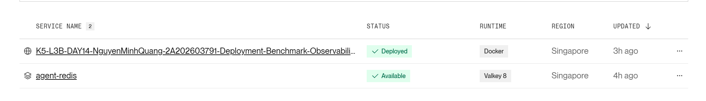
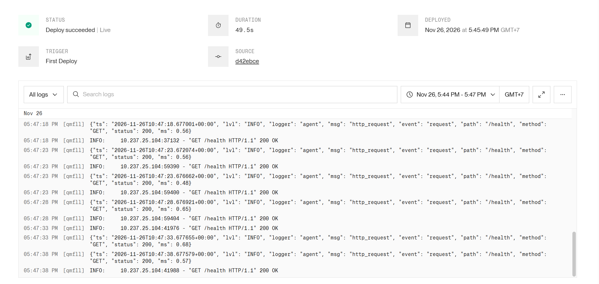
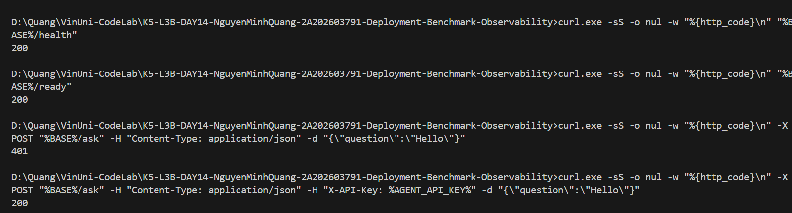

# Day 14 Lab — Mission Answers

> **Lưu ý trước khi nộp:** Không ghi email, số điện thoại, `.env` hay secret/token thật vào file này (che token trước khi dán output `curl`).

---

## Part 1: Localhost vs Production (CP1)

### Exercise 1.1: Anti-patterns tìm thấy trong `01-localhost-vs-production/develop/app.py`
1. **API key & secret hardcode trong code (dòng 17–18):** `OPENAI_API_KEY` và `DATABASE_URL` được gán trực tiếp bằng chuỗi cứng; nếu push lên GitHub sẽ bị lộ ngay lập tức.
2. **Không có config management (dòng 21–22):** `DEBUG = True`, `MAX_TOKENS = 500` bị hardcode, không thể đổi cấu hình theo môi trường (dev/staging/prod) mà không sửa code.
3. **Dùng `print()` thay vì structured logging và log ra secret (dòng 33–38):** `print()` không có log level, không có timestamp/JSON format, bị buffer và đặc biệt dòng 34 còn in thẳng `OPENAI_API_KEY` ra stdout.
4. **Thiếu health check endpoint (dòng 42–43):** Không có `/health` hay `/ready` để platform/load balancer biết service còn sống hay đã sẵn sàng nhận traffic.
5. **Cấu hình server cứng cho localhost (dòng 49–54):** `host="localhost"` (chỉ nhận request nội bộ, không chạy được trong container), `port=8000` (không đọc biến `PORT` do cloud inject), và `reload=True` (bật auto-reload trong production).
6. **Không xử lý graceful shutdown:** Khi nhận tín hiệu tắt (`SIGTERM`), server dừng đột ngột, dễ cắt ngang request đang xử lý.

### Exercise 1.2: Kết quả chạy và gọi bản `develop`
Lệnh đã chạy: `curl.exe -X POST "http://localhost:8000/ask?question=Hello"`

```json
{"answer":"Tôi là AI agent được deploy lên cloud. Câu hỏi của bạn đã được nhận."}
```

### Exercise 1.3: So sánh `develop` vs `production`

| Feature | Develop (`develop/app.py`) | Production (`production/app.py`) | Tại sao quan trọng? |
|---|---|---|---|
| Config | Hardcode `OPENAI_API_KEY`, `DATABASE_URL`, `DEBUG`, `MAX_TOKENS` trực tiếp trong code (dòng 17–22) | Đọc từ biến môi trường qua `Settings` trong `config.py` (dòng 15–50), có `validate()` fail-fast | Tách biệt config khỏi code (12-Factor), không lộ secret lên Git, đổi cấu hình theo từng môi trường dễ dàng |
| Health check | Không có | Có `GET /health` (liveness, dòng 135–149) và `GET /ready` (readiness, dòng 152–161) | Platform (Railway/Render/Docker) dùng để kiểm tra service còn sống và sẵn sàng nhận traffic hay chưa trước khi route request |
| Logging | Dùng `print()` text thô, không có level, in cả `OPENAI_API_KEY` (dòng 33–38) | Dùng `logging` định dạng JSON (dòng 28–32, 111–122), không log secret | Dễ thu thập, parse và tìm kiếm trên log aggregator (Loki, Datadog...), kiểm soát log level và tránh rò rỉ thông tin nhạy cảm |
| Shutdown | Không xử lý, tắt đột ngột | Có `lifespan` (dòng 40–67) và bắt `SIGTERM` bằng `handle_sigterm` (dòng 180–189) | Cho phép các request đang xử lý (in-flight) hoàn thành trước khi container tắt khi deploy/scale |
| Host / Port | Cứng `host="localhost"`, `port=8000`, `reload=True` (dòng 51–53) | Đọc `settings.host` (mặc định `0.0.0.0`), `settings.port` (env `PORT`), `reload=settings.debug` (dòng 194–198) | Container và cloud platform yêu cầu bind `0.0.0.0` và lắng nghe đúng cổng `PORT` được cấp phát động |

**Ví dụ cụ thể anti-pattern đã được sửa (kèm số dòng):**
- Trong `develop/app.py` (dòng 17): `OPENAI_API_KEY = "sk-hardcoded-fake-key-never-do-this"` hardcode trực tiếp secret vào code, và dòng 34 (`print(f"[DEBUG] Using key: {OPENAI_API_KEY}")`) làm lộ secret ra log.
- Trong `production/app.py` (dòng 24) và `production/config.py` (dòng 27, 32): toàn bộ secret được đọc từ biến môi trường (`os.getenv("OPENAI_API_KEY", "")`, `os.getenv("AGENT_API_KEY", "")`), và trong `production/app.py` (dòng 111–115) chỉ log `question_length` và `client_ip` dạng JSON, tuyệt đối không log secret.

---

## Part 2: Docker (CP2)

### Exercise 2.1: Câu hỏi về `02-docker/develop/Dockerfile`
1. **Base image là gì?** `python:3.11` (bản Python đầy đủ, dung lượng lớn ~1 GB).
2. **Working directory là gì?** `/app` (`WORKDIR /app`).
3. **Tại sao `COPY requirements.txt` trước `COPY . .`?** Để tận dụng Docker layer cache: khi chỉ sửa code (`app.py`) mà không đổi thư viện, Docker tái sử dụng lại layer `pip install` đã cache, không phải cài lại dependencies từ đầu.
4. **`CMD` vs `ENTRYPOINT` khác nhau thế nào?** `ENTRYPOINT` định nghĩa lệnh thực thi chính cố định của container (khó bị ghi đè khi `docker run`), còn `CMD` cung cấp lệnh mặc định hoặc tham số mặc định cho `ENTRYPOINT` và dễ bị ghi đè bằng tham số truyền thêm ở cuối `docker run`.

### Exercise 2.2: Kết quả gọi container `my-agent:develop`
Lệnh đã chạy: `curl.exe -X POST "http://localhost:8000/ask?question=What+is+Docker?"`

```json
{"answer":"Container là cách đóng gói app để chạy ở mọi nơi. Build once, run anywhere!"}
```

### Exercise 2.3: So sánh kích thước image (`docker images`)
- `my-agent:develop`: `1.67GB` (~`1670` MB)
- `my-agent:advanced`: `240` MB
- **Chênh lệch:** giảm **`85.6%`** (nhỏ hơn gần 7 lần)
- **Giải thích vì sao multi-stage build làm image nhỏ hơn (giảm ở đâu):**
  - `develop/Dockerfile` dùng base image `python:3.11` đầy đủ (chứa nhiều công cụ hệ thống và thư viện không cần thiết lúc chạy) nên nặng `1.67GB`.
  - `production/Dockerfile` dùng `python:3.11-slim` và tách 2 stage: **Stage 1 (`builder`)** cài `gcc`, `libpq-dev` và compile toàn bộ dependencies vào `/root/.local`; **Stage 2 (`runtime`)** chỉ copy phần packages đã build (`/root/.local`) và source code sang một image `python:3.11-slim` sạch, bỏ lại toàn bộ compiler (`gcc`), header (`libpq-dev`), `apt` cache và lớp trung gian.

### Exercise 2.4: Docker Compose stack (`02-docker/production/docker-compose.yml`)
**Sơ đồ kiến trúc các service & luồng giao tiếp:**
```text
                  ┌──► redis:7-alpine (port 6379 — session cache & rate limit)
Client ──► nginx ─┼──► agent (FastAPI, port 8000, không expose ra ngoài)
                  └──► qdrant:v1.9.0 (port 6333 — vector DB cho RAG)
                       (Tất cả giao tiếp qua bridge network "internal")
```
- `nginx` đóng vai trò reverse proxy / load balancer nhận traffic từ bên ngoài rồi chuyển tiếp vào `agent:8000` (service `agent` không expose port trực tiếp ra host).
- `agent` kết nối tới `redis:6379` (qua `REDIS_URL=redis://redis:6379/0`) và `qdrant:6333` (qua `QDRANT_URL=http://qdrant:6333`) thông qua Docker DNS nội bộ trên network `internal`, và chỉ khởi động sau khi `redis` & `qdrant` đều đạt `service_healthy`.

**Kết quả test qua Nginx (`http://localhost:8081/health` và `http://localhost:8081/ask`, đổi tạm từ cổng 80 do Windows giữ cổng 80):**
```json
GET /health:
{"status":"ok","uptime_seconds":261.9,"version":"2.0.0","timestamp":"2026-11-26T08:51:49.550104"}

POST /ask:
{"answer":"Tôi là AI agent được deploy lên cloud. Câu hỏi của bạn đã được nhận."}
```

---

## Part 3: Cloud Deployment (CP6)

### Exercise 3.1 / 3.2: Deploy agent Part 6 (`06-lab-complete/`)
- **Nền tảng sử dụng:** Render (Docker Web Service + Render Key Value Redis)
- **Public URL:** `https://k5-l3b-day14-nguyenminhquang-2a202603791.onrender.com`
- **Screenshots:**
  - `screenshots/dashboard.png`
    
  - `screenshots/running.png`
    
  - `screenshots/test.png`
    

**Kết quả 4 lệnh tự kiểm (CP6):**
```text
GET /health               -> 200
GET /ready                -> 200
POST /ask (no X-API-Key)  -> 401
POST /ask (with X-API-Key)-> 200
```

### So sánh `railway.toml` và `render.yaml`
- **Điểm khác nhau:**
  - **Định dạng & cấu trúc:** `railway.toml` dùng định dạng TOML tập trung vào từng service (`[build]` chọn `builder = "DOCKERFILE"`, `[deploy]` đặt `healthcheckPath`, `restartPolicyType`), còn `render.yaml` dùng định dạng YAML theo mô hình Blueprint (khai báo toàn bộ hạ tầng trong `services:` gồm `type: web`, `runtime: docker`, `healthCheckPath`, và có thể khai báo luôn cả `envVars` lẫn database/Redis đi kèm).
  - **Quản lý biến môi trường & secret:** `railway.toml` không khai báo `envVars` trong file config (biến môi trường & secret được set riêng qua CLI `railway variables set` hoặc Dashboard), trong khi `render.yaml` cho phép khai báo trực tiếp danh sách `envVars` ngay trong file IaC và hỗ trợ `generateValue: true` (tự sinh secret) hoặc `sync: false` (nhập tay trên Dashboard để không lộ secret vào Git).
- **Vì sao khác nhau:** Railway thiết kế theo hướng tối giản cấu hình per-service (chỉ định cách build/healthcheck rồi quản lý env/plugin qua CLI/Dashboard), còn Render Blueprint thiết kế theo hướng **Infrastructure-as-Code (IaC)** để có thể dựng lại toàn bộ stack (service + env + Redis) từ 1 file YAML duy nhất trong repo.

### Exercise 3.3: Cloud Run CI/CD (`03-cloud-deployment/production-cloud-run/`)
Pipeline trong `cloudbuild.yaml` tự động chạy qua 4 bước tuần tự khi push code lên branch `main`:
1. **`test`:** Chạy container `python:3.11-slim`, cài dependencies từ `requirements.txt` và chạy `pytest tests/` để đảm bảo code pass test trước khi đóng gói.
2. **`build`:** Dùng `gcr.io/cloud-builders/docker` build Docker image (tận dụng `--cache-from` từ tag `latest`) và gắn tag theo `$COMMIT_SHA` và `latest`.
3. **`push`:** Đẩy image vừa build lên Google Container Registry (`gcr.io/$PROJECT_ID/ai-agent`).
4. **`deploy`:** Dùng `gcloud run deploy` cập nhật service `ai-agent` lên Cloud Run (`asia-southeast1`), cấu hình scale (`min-instances=1` tránh cold start, `max-instances=10`), giới hạn CPU/RAM (`512Mi`, `1 CPU`), và lấy secret an toàn từ **Secret Manager** (`--set-secrets`) kết hợp cấu hình `service.yaml` (có `livenessProbe` `/health` và `startupProbe` `/ready`).

---

## Part 4: API Security (CP3)

### Exercise 4.1: API Key Authentication (`04-api-gateway/develop/`)
**Khi thiếu hoặc sai `X-API-Key` (`401`):**
```http
HTTP/1.1 401 Unauthorized
date: Thu, 26 Nov 2026 09:02:27 GMT
server: uvicorn
content-length: 67
content-type: application/json

{"detail":"Missing API key. Include header: X-API-Key: <your-key>"}
```

**Khi đúng `X-API-Key` (`200`):**
```http
HTTP/1.1 200 OK
date: Thu, 26 Nov 2026 09:02:35 GMT
server: uvicorn
content-length: 114
content-type: application/json

{"question":"Hello","answer":"Agent đang hoạt động tốt! (mock response) Hỏi thêm câu hỏi đi nhé."}
```

### Exercise 4.2 & 4.3: JWT & Rate Limiting (`04-api-gateway/production/`)
*(Nhớ che JWT token trước khi dán)*

**Gọi hợp lệ với token (`200`):**
```http
HTTP/1.1 200 OK
date: Thu, 26 Nov 2026 09:05:36 GMT
server: uvicorn
content-length: 196
content-type: application/json
x-content-type-options: nosniff
x-frame-options: DENY
x-xss-protection: 1; mode=block
referrer-policy: strict-origin-when-cross-origin

{"question":"what is docker?","answer":"Container là cách đóng gói app để chạy ở mọi nơi. Build once, run anywhere!","usage":{"requests_remaining":9,"budget_remaining_usd":1.9e-05}}
```

**Vòng lặp vượt quá giới hạn 10 request/phút (`429`):**
```http
# Lệnh đã chạy (đã che token):
# for /L %i in (1,1,12) do curl.exe -s -i -X POST http://localhost:8000/ask -H "Authorization: Bearer <REDACTED_JWT_TOKEN>" -H "Content-Type: application/json" -d "{\"question\": \"test %i\"}"

# Request 1..9 trả về 200 OK (requests_remaining giảm dần từ 8 về 0)
# Từ request 10 trở đi bị chặn với mã 429:
HTTP/1.1 429 Too Many Requests
date: Thu, 26 Nov 2026 09:06:13 GMT
server: uvicorn
x-ratelimit-limit: 10
x-ratelimit-remaining: 0
x-ratelimit-reset: 1795684034
retry-after: 22
content-length: 98
content-type: application/json
x-content-type-options: nosniff
x-frame-options: DENY
x-xss-protection: 1; mode=block
referrer-policy: strict-origin-when-cross-origin

{"detail":{"error":"Rate limit exceeded","limit":10,"window_seconds":60,"retry_after_seconds":22}}
```

### Exercise 4.4: Cost Guard
- **Cách triển khai Cost Guard:**
  - Theo dõi lượng token (`input_tokens`, `output_tokens`) và quy đổi ra chi phí USD theo đơn giá model sau mỗi request (`record_cost`), lưu theo từng user/API key và tổng toàn hệ thống theo ngày/tháng (trong production lưu trên Redis/DB thay vì RAM).
  - Trước khi gọi LLM ở endpoint `/ask`, gọi `check_budget()`: nếu chi phí đã đạt hoặc vượt ngưỡng ngân sách (`DAILY_BUDGET_USD` / `MONTHLY_BUDGET_USD`), chặn ngay và trả về HTTP `402 Payment Required` (hoặc `429`), đồng thời log cảnh báo khi đạt mốc ~80% ngân sách.
- **Vì sao cần cả Rate Limit lẫn Cost Guard (khác nhau thế nào)?**
  - **Rate Limit** bảo vệ **tốc độ / lưu lượng** (số request trong một cửa sổ thời gian, vd `10 req/phút`) để chống spam/DDoS và quá tải server.
  - **Cost Guard** bảo vệ **tiền / ngân sách** (tổng chi phí USD tích lũy theo ngày/tháng). Một người dùng vẫn có thể gọi rất chậm để lách rate limit (vd 5 req/phút liên tục cả ngày với prompt rất dài) khiến hóa đơn LLM tăng vọt — lúc này chỉ có Cost Guard mới chặn được.

---

## Part 5: Scaling & Reliability (CP4)

### Exercise 5.1 & 5.2: Health Check & Graceful Shutdown
- **Liveness (`/health`) khác Readiness (`/ready`) ở đâu?**
  - **Liveness (`GET /health`):** Trả lời câu hỏi *"Process còn sống không?"* — luôn trả `200 OK` miễn là app không bị treo/deadlock (kể cả khi dependency như Redis tạm mất). Nếu `/health` lỗi, platform/orchestrator sẽ **restart container**.
  - **Readiness (`GET /ready`):** Trả lời câu hỏi *"App đã sẵn sàng nhận traffic chưa?"* — kiểm tra app đã khởi động xong và các dependency bắt buộc (như Redis) có kết nối được không; nếu chưa sẵn sàng hoặc đang shutdown (`_is_ready = False`) thì trả **`503`**. Load balancer dựa vào `/ready` để **ngừng route request mới** vào instance đó (không restart).
- **Graceful shutdown hoạt động thế nào khi nhận `SIGTERM`?**
  - Khi nhận tín hiệu `SIGTERM` (lúc deploy bản mới hoặc scale down), app đặt cờ `_is_ready = False` để `/ready` trả `503` (load balancer ngừng gửi request mới tới), sau đó chờ các request đang xử lý dở (`_in_flight_requests > 0`) hoàn thành trong khoảng timeout trước khi đóng kết nối và thoát sạch với exit code `0`.

### Exercise 5.3 – 5.5: Stateless & Scaling (`05-scaling-reliability/production/`)
- **Vì sao lưu state trong RAM bị hỏng khi scale nhiều instance?**
  - Mỗi container/instance có vùng nhớ RAM riêng biệt. Khi Nginx load balancer phân phối các request của cùng 1 người dùng sang các instance khác nhau (ví dụ câu 1 vào `instance-1`, câu 2 vào `instance-2`), `instance-2` không có dữ liệu hội thoại/rate-limit nằm trong RAM của `instance-1`, dẫn đến mất ngữ cảnh hoặc đếm sai giới hạn.
- **Kết quả chạy `python test_stateless.py` (với `--scale agent=3`):**
```text
============================================================
Stateless Scaling Demo
============================================================

Session ID: a783603e-51b0-42ac-9f09-6c12a2bec5b0

Request 1: [instance-e10d2a]
  Q: What is Docker?
Request 2: [instance-50712b]
  Q: Why do we need containers?
Request 3: [instance-22104b]
  Q: What is Kubernetes?
Request 4: [instance-e10d2a]
  Q: How does load balancing work?
Request 5: [instance-50712b]
  Q: What is Redis used for?

------------------------------------------------------------
Total requests: 5
Instances used: {'instance-22104b', 'instance-50712b', 'instance-e10d2a'}
✅ All requests served despite different instances!

--- Conversation History ---
Total messages: 10
✅ Session history preserved across all instances via Redis!
```
- **Giải thích kết quả:**
  - Nginx đã cân bằng tải 5 request cùng `session_id` qua cả **3 instance khác nhau** (`instance-e10d2a`, `instance-50712b`, `instance-22104b`).
  - Nhờ toàn bộ lịch sử hội thoại được lưu tập trung trong **Redis** (thay vì RAM từng container), khi truy vấn `/chat/{session_id}/history` vẫn lấy lại đầy đủ **10 messages** (5 câu hỏi + 5 câu trả lời) mà không bị mất dữ liệu.

---

## Part 6: Final Project — Production-Ready Agent (CP5)

Kết quả chạy `python check_production_ready.py` trong `06-lab-complete/` (trên Windows — `42/42 checks passed`; riêng `SIGTERM` ngoài Docker báo ⚠️ do Windows không gửi được SIGTERM và mạng trường chặn `wsl --update` 403, còn `docker stop` trong Docker đã pass với `exit code 0, 0.9s`; image size `56 MB`):

```text
  📋 Checklist Deliverable
     ✅ Dockerfile (multi-stage, < 500 MB)
     ✅ docker-compose.yml (agent + redis)
     ✅ .dockerignore
     ✅ Health check endpoint (GET /health)
     ✅ Readiness endpoint (GET /ready)
     ✅ API Key authentication
     ✅ Rate limiting
     ✅ Cost guard
     ✅ Config từ environment variables
     ✅ Structured logging
     ⚠️  Graceful shutdown
     ✅ Public URL ready (Railway / Render config)
----------------------------------------------------------------
  Result: 11/12 tiêu chí đạt · 42/42 checks passed
```

---

## AI Log

*(Ghi lại các lần dùng AI cho code Part 6 hoặc câu trả lời theo quy định trong `RULES.md`: hỏi gì, nhận gì, bạn tự sửa và tự kiểm tra thế nào)*

| Lần | Phần | Hỏi gì | Nhận gì | Tự sửa & tự kiểm tra thế nào |
|---|---|---|---|---|
| 1 | Part 1–5 | Hướng dẫn chạy từng checkpoint, giải thích log secret, docker, stateless, so sánh `railway.toml` vs `render.yaml`, Cloud Run CI/CD | Câu lệnh PowerShell/cmd, giải thích thiết kế và mẫu trình bày | Tự chạy lại tất cả ví dụ `01`–`05` trên máy, tự đo `docker images`, tự chạy `curl` lấy mã `401`/`200`/`429` và `test_stateless.py` |
| 2 | Part 6 (`06-lab-complete/`) | Hướng dẫn từng bước thiết kế và hoàn thiện 12 tiêu chí (`config.py`, `auth.py`, `redis_client.py`, `rate_limiter.py`, `cost_guard.py`, `main.py`, `Dockerfile`, `docker-compose.yml`, `.dockerignore`, `railway.toml`, `render.yaml`) | Code khung chuẩn production và giải thích từng thành phần | Tự kiểm tra `--static-only` (26/27 checks, chỉ 1 mục compose CLI trong sandbox) và deploy thật lên Render (kèm Key Value Redis), tự test 4 lệnh `200`/`200`/`401`/`200` |
| 3 | Part 7 (CP7) | Hỗ trợ chạy eval với `PYTHONUTF8=1`, bổ sung 2 entry `KNOWLEDGE_BASE` (`security-02`, `scaling-03`) và tổng hợp số liệu từ JSON | Đã chạy lại `eval_v2_fixed.json` đạt `100% (23/23)` | Tự chạy 7 file `load_test.py` trên máy và đối chiếu toàn bộ số liệu trong `BENCHMARK_REPORT.md` với 10 file JSON trong `reports/` |
